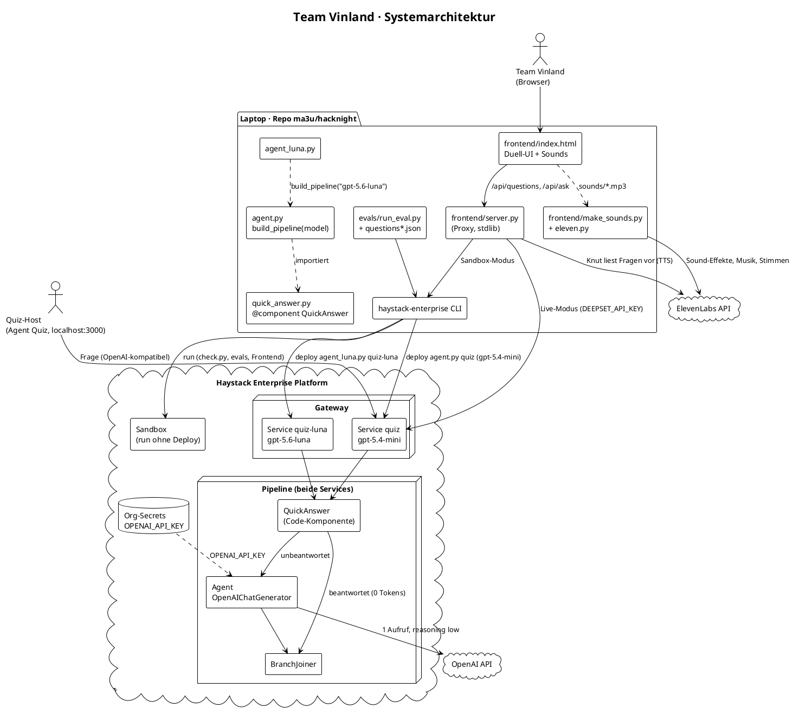
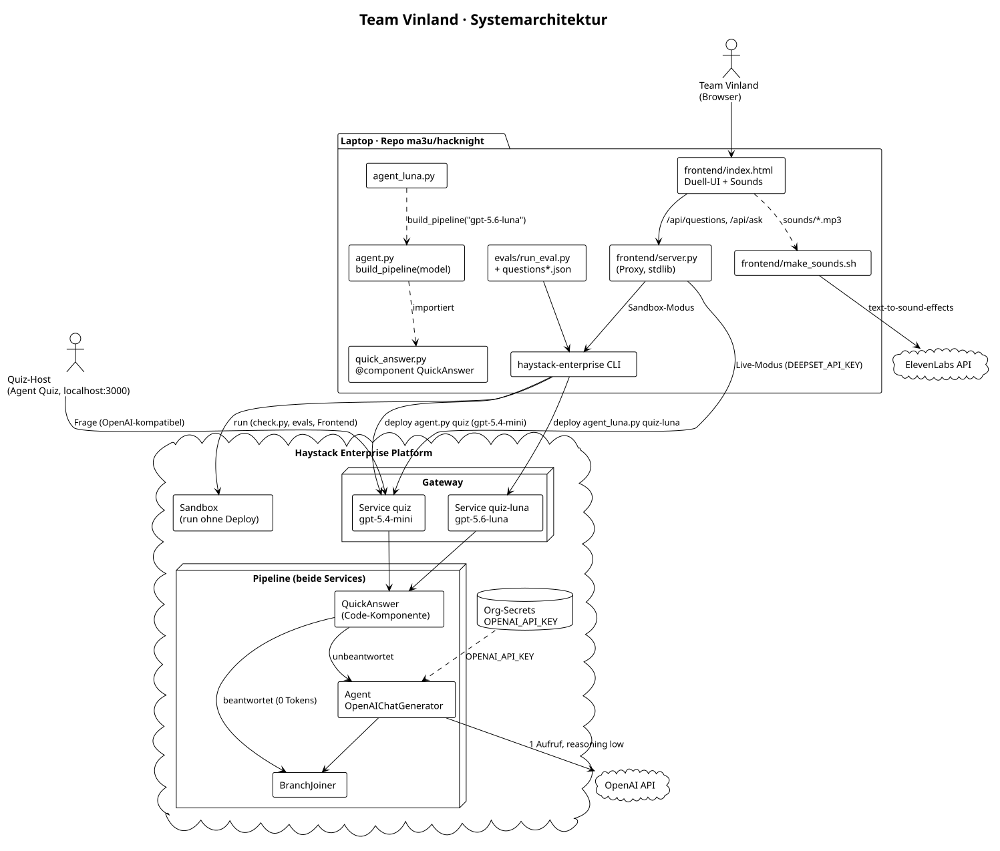
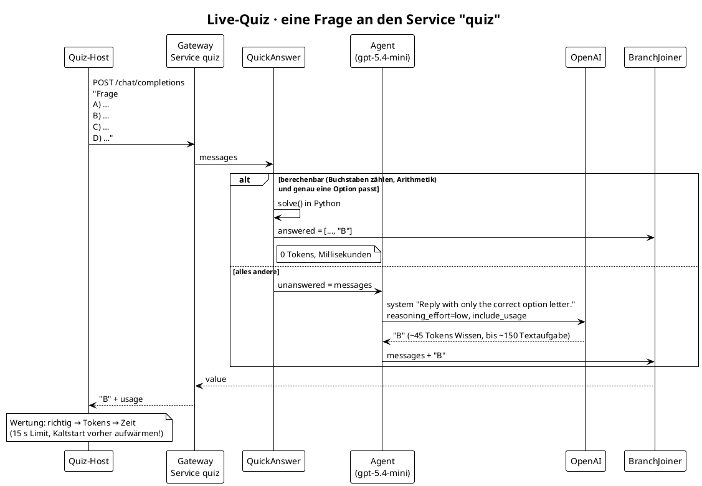
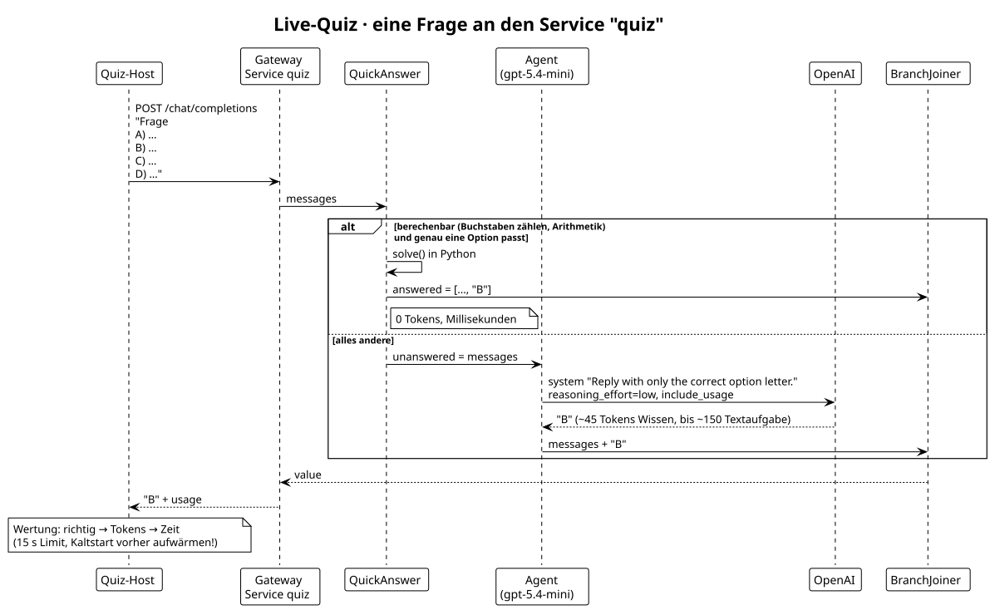
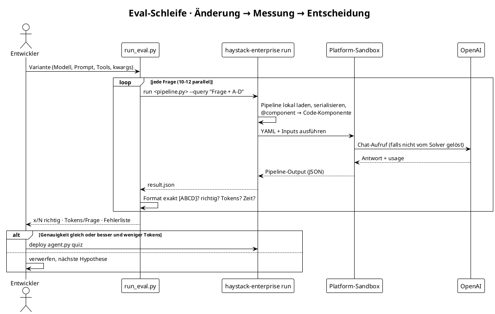
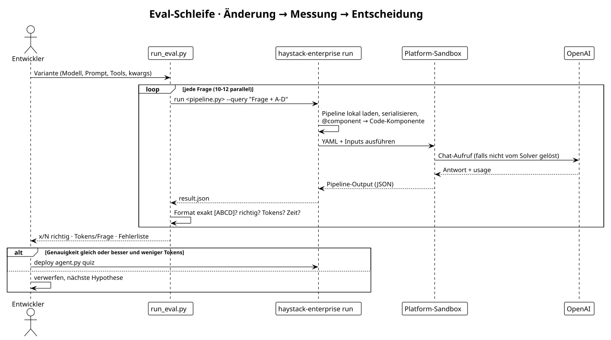
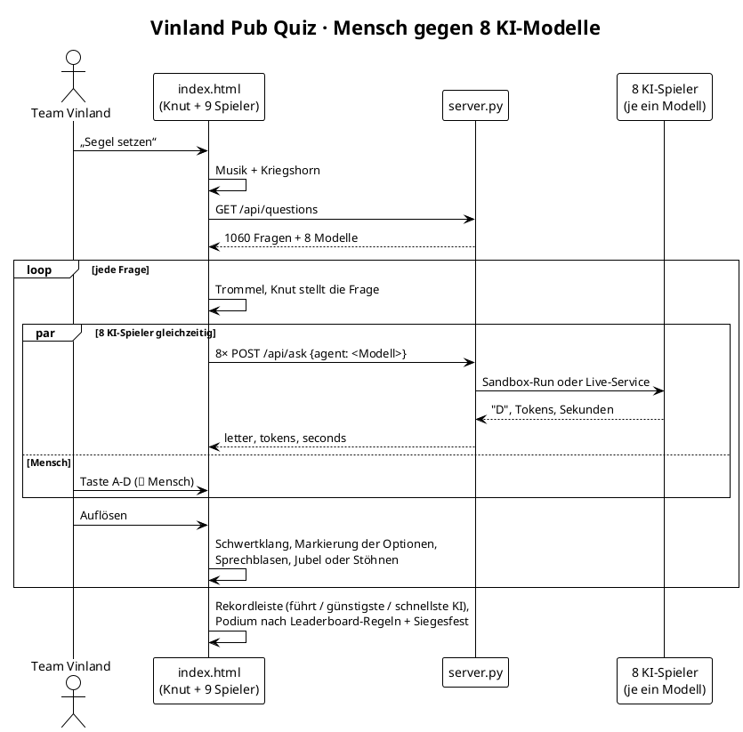
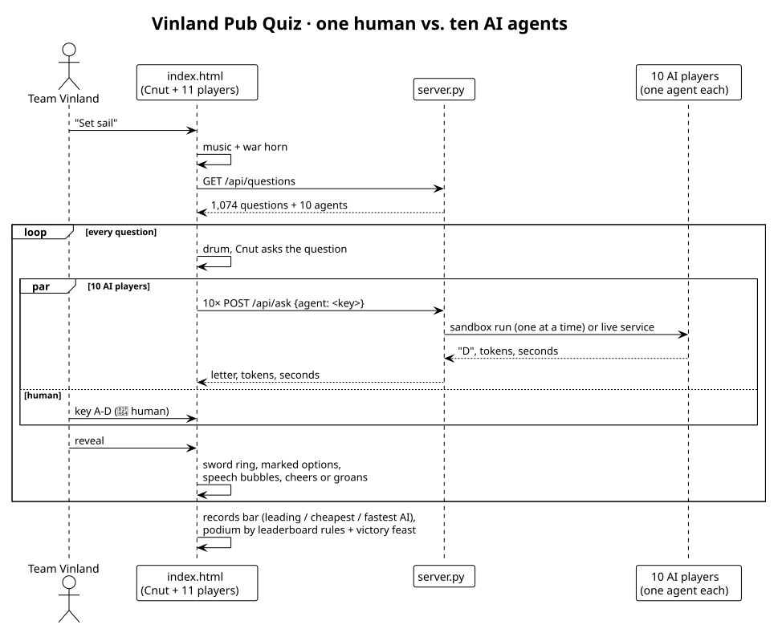

# Team Vinland · Strategie für die Quiz Agent Challenge

> hacknight · Haystack Enterprise Platform · Workspace `vinland` · Fork [`ma3u/hacknight`](https://github.com/ma3u/hacknight)

## 1. Aufgabe und Wertung

Der Agent bekommt eine Multiple-Choice-Frage (A–D) und muss mit **genau einem Buchstaben** antworten.
Das Leaderboard wertet in dieser Reihenfolge:

| Rang | Kriterium | Folgerung für uns |
|---|---|---|
| 1 | meiste richtige Antworten (15 s Limit) | Genauigkeit und Format gehen vor allem anderen |
| 2 | wenigste **Tokens** | Tokens zählen modellunabhängig: ein „billiges“ Modell spart Geld, aber keine Tokens |
| 3 | schnellste Gesamtzeit | erst relevant, wenn 1 und 2 gleich sind |

## 2. Strategie in fünf Sätzen

1. **Was nicht gesendet wird, kostet nichts:** Tool-Schemas und lange Systemprompts werden bei *jeder* Frage bezahlt. Darum: keine Tools, ein Prompt aus sieben Wörtern.
2. **Denken nur, wo es nötig ist:** `reasoning_effort: low` kostet bei Wissensfragen exakt so viele Tokens wie `none` (gemessen: Differenz 0), denkt aber bei Rechen- und Textaufgaben kurz nach.
3. **Was Python ausrechnen kann, braucht kein LLM:** Die Komponente `QuickAnswer` löst Buchstaben-Zählfragen und reine Arithmetik exakt, mit **0 Tokens**, und antwortet nur, wenn genau eine Option passt.
4. **Haystack-Bordmittel statt Eigenbau:** `Pipeline`, `Agent`, `OpenAIChatGenerator`, `BranchJoiner` und ein einziger `@component`.
5. **Jede Änderung muss den Eval bestehen:** 60 eigene Fragen plus 1000 Fragen aus [The Trivia API](https://the-trivia-api.com). Eine Änderung bleibt nur, wenn die Genauigkeit nicht sinkt.

## 3. Systemarchitektur

Die PlantUML-Quellen liegen zusätzlich in [`diagrams/`](diagrams/) (neu rendern: `plantuml -tsvg docs/diagrams/*.puml`).





## 4. Sequenzdiagramme

### 4.1 Eine Quizfrage im Live-Quiz





### 4.2 Eval-Iteration (wie jede Änderung geprüft wurde)





### 4.3 Agenten-Duell im Frontend





## 5. Eval-Ergebnisse

### 5.1 Iterationen auf 60 eigenen Fragen (40 normal + 20 schwer)

| # | Variante | Richtig | Tokens/Frage | Erkenntnis |
|---|---|---|---|---|
| 0 | Starter: gpt-5.1 + `calculate` + `count_letter` | 39/40 | 460 | Tool-Schemas bei jeder Frage, Tool-Aufruf = zweiter LLM-Call |
| 1 | gpt-4.1, kein Prompt, `logit_bias` A–D, 1 Token | 28/40 | 38 | ohne Anweisung tippt das Modell meist „A“ |
| 2 | gpt-5.1 ohne Tools, Kurzprompt | 34/40 | 58 | Arithmetik scheitert ohne Nachdenken |
| 2 | `max_completion_tokens: 1` bei gpt-5.x | 0/40 | – | HTTP 400, die Obergrenze ist ohnehin nur ein Deckel |
| 3 | **gpt-5.4, `reasoning_effort: low`, keine Tools** | **40/40** | **66** | Denken ersetzt Tools, Tokens nur wo nötig |
| 3 | gpt-5.4 nur mit `calculate` | 37/40 | 274 | Tool kostet und lieferte teils leere Antworten |
| 4 | Prompt „Letter only.“ | 39/40 | 68 | antwortete einmal „C) Carbon dioxide“ → zurück zum 7-Wort-Prompt |
| 5 | **Pipeline: QuickAnswer → Agent → BranchJoiner** | **60/60** | **46 / 52** | 17 von 60 Fragen mit 0 Tokens, −33 % gegenüber Iteration 3 |

### 5.2 1000 Fragen aus The Trivia API (47 % schwer, 10 Kategorien)

| Agent | Richtig | Tokens/Frage | Anmerkung |
|---|---|---|---|
| **quiz** (gpt-5.4, Pipeline) | **993/1000** | 76 | 0 Formatfehler; 1 Fehler war ein Plattform-Aussetzer (502), 1 „Fehler“ ist ein Fehler im Datensatz (Dromedar: 0 statt 1 Höcker) |
| Luna-Fork (wie auf der Plattform angelegt) | 1/1000 | 68 | 999 Formatfehler wie „D) Inception“; der Buchstabe am Anfang stimmte 962-mal: Wissen da, Format kaputt |
| **Luna repariert** (`agent_luna.py`) | **993/1000** | **61** | 0 Formatfehler; gleiche Pipeline, nur Modell getauscht: **−19 % Tokens bei gleicher Genauigkeit** |

Je drei Fragen konnte nur gpt-5.4 bzw. nur Luna richtig beantworten; die übrigen Fehler teilen sich beide Modelle und
betreffen überwiegend fragwürdige Lösungen im Datensatz (Dromedar-Höcker, Erfindungsjahr der CD). **Bei Gleichstand der
richtigen Antworten gewinnt nach den Regeln Luna, weil es 19 % weniger Tokens braucht.**

### 5.3 Acht Modelle, gleiche Pipeline, gleiche Fragen

Die vollständige Tabelle mit Genauigkeit und isolierter Geschwindigkeit pro Agent: [`evals/RESULTS.md`](../evals/RESULTS.md)
(neu erzeugen: `uv run python evals/summarize.py`). Isoliert gemessen ist gpt-5.4-mini mit 3,0 s auch das schnellste der genauesten Modelle.

Alle Modelle laufen in derselben Pipeline (Solver + Agent), jeweils mit ihrer besten Einstellung: Reasoning-Modelle mit
`reasoning_effort: low`, gpt-4.1/gpt-4o-mini mit 1 Token und `logit_bias` auf A–D (sonst antworten sie „C) 87.5%“).

| Modell | Trivia 200 (hohe Last) | Eigene 60 (geringe Last) | Median-Zeit (geringe Last) | Tokens/Frage (eigene 60) |
|---|---|---|---|---|
| **gpt-5.4-mini** | **200** | **59** | **10,4 s** | 49 |
| gpt-5.4 | 199 | 59 | 10,7 s | 49 |
| gpt-5.1 | 200 | 59 | 10,8 s | 48 |
| gpt-5-mini | 199 | 59 | 11,4 s | 50 |
| gpt-4.1 | 199 | 57 | 10,0 s | 36 |
| gpt-5.6-luna | 197 | 57 | 11,1 s | 39 |
| gpt-4o-mini | 195 | 55 | 10,0 s | 36 |
| gpt-5.4-nano | 191 | 58 | 10,8 s | 48 |

- Die Zeiten enthalten den Sandbox-Start (~8–10 s); Unterschiede zwischen den Modellen liegen bei Zehntelsekunden.
  Unter hoher Last (48 parallele Läufe) waren Luna und gpt-5.4 im Paarvergleich gleich schnell (Median-Differenz 0,02 s).
- gpt-4.1 und gpt-4o-mini sind am schnellsten und günstigsten, verlieren aber bei Textaufgaben (Zug, Wechselgeld, Datumsrechnung)
  2–5 Punkte. Bei „genau vor schnell“ scheiden sie aus; in einer 5-Fragen-Runde nur mit Wissensfragen gewinnen sie trotzdem.
- **Entscheidung (Ziel: genau, dann schnell): `quiz` läuft seit 20:22 auf gpt-5.4-mini** — am genauesten und unter den
  genauen Modellen am schnellsten. `quiz-luna` bleibt als reparierte Luna-Variante.
- Live gemessen: nach frischem Deploy (Kaltstart) 10–18 s, warm unter 2 s. **Vor dem Quiz aufwärmen ist Pflicht.**

## 6. Der Luna-Fix

Der Fork `quiz-cf5ea67e-fork` (Service `quiz-luna`) übernahm die Pipeline, verlor aber beim Modellwechsel im Builder den
Systemprompt und alle `generation_kwargs`. Folgen: Luna antwortete in ganzen Sätzen, und gestreamte Antworten meldeten keine Tokens.
Der Fix ist [`agent_luna.py`](../agent_luna.py): `build_pipeline("gpt-5.6-luna")` aus [`agent.py`](../agent.py), deployt als neue
Revision von `quiz-luna`. So bleiben beide Agenten identisch bis auf das Modell, und ein Vergleich misst wirklich nur das Modell.

## 7. Risiken und offene Punkte

- **Sandbox-Warteschlange:** Ein Lauf allein dauert 2–4 s, drei gleichzeitig 6–14 s. Das Frontend lässt die 8 KIs deshalb nacheinander laufen (`SANDBOX_PARALLEL=1`).
- **Kaltstart:** Serverless-Services gehen in „Standby“; die erste Frage kann 6–16 s brauchen (Limit 15 s). Kurz vor dem Quiz eine Frage senden.
- **Token-Zählung bei 0-Token-Antworten:** Wie das Leaderboard Antworten ohne LLM-Aufruf (fehlendes `usage`) wertet, ist nicht bestätigt.
- **Datensatzfehler:** Öffentliche Trivia-Sets enthalten falsche Lösungen; 99 %+ ist nahe an der Messgrenze.
- **Fragen vorab beschaffen** wäre Schummeln und ist nicht Teil der Strategie; der Solver rechnet nur, was sich aus der Frage selbst ergibt.

## 8. So läuft alles

```bash
uv sync
uv run python check.py                                   # 3 Beispielfragen in der Sandbox
QZ_SET=trivia/questions_trivia.json QZ_TAG=_trivia uv run python evals/run_eval.py p1_pipeline
haystack-enterprise deploy agent.py quiz                 # gpt-5.4
haystack-enterprise deploy agent_luna.py quiz-luna --io-config agent.io.yaml
uv run python frontend/make_sounds.py                    # ElevenLabs (CLI oder ELEVEN_LABS_API_KEY aus .env), einmalig
uv run python frontend/server.py                         # http://localhost:8765
```
