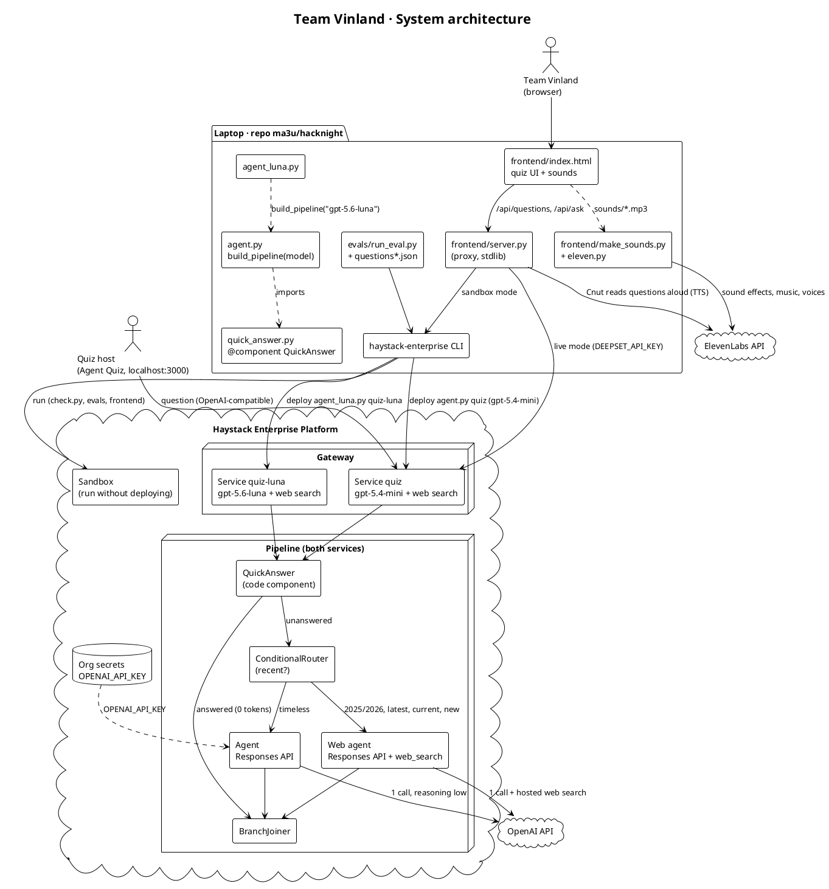
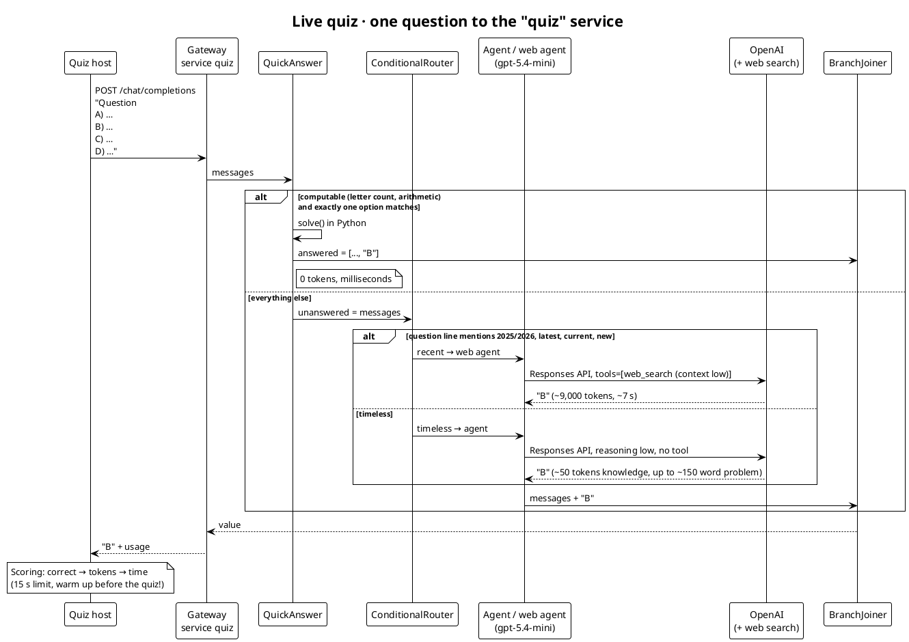
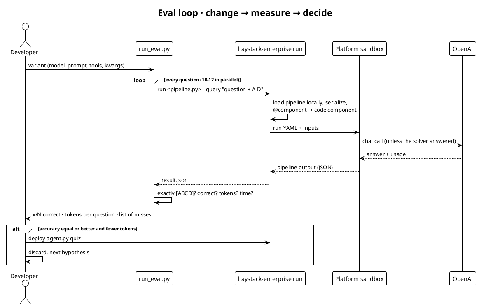
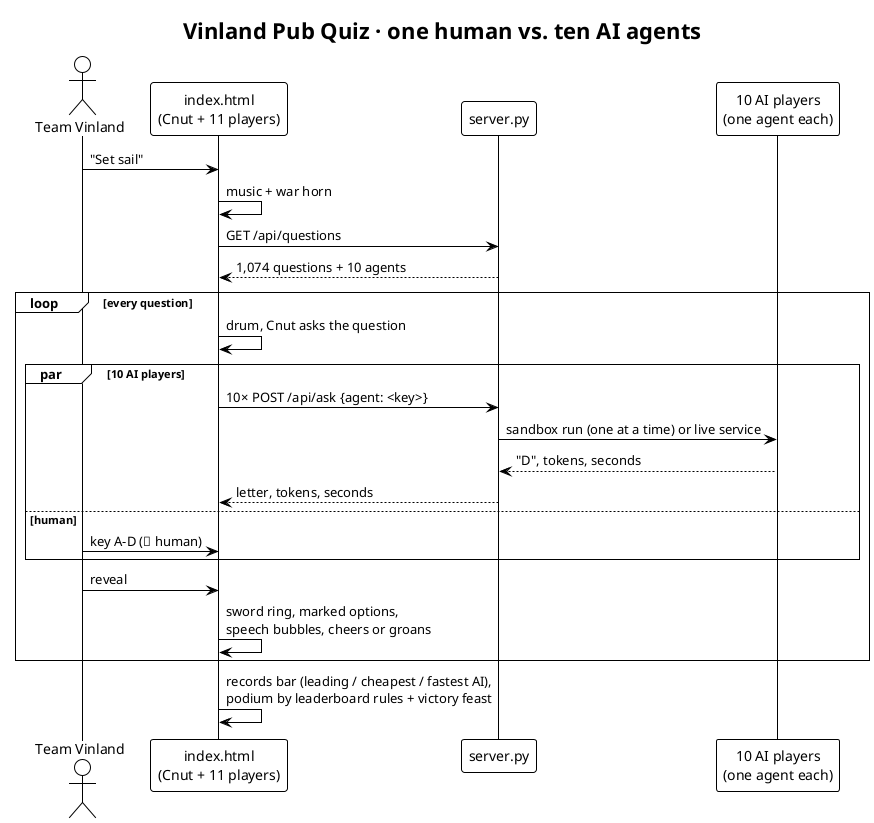

# Team Vinland · Strategy for the Quiz Agent Challenge

> hacknight · Haystack Enterprise Platform · workspace `vinland` · fork [`ma3u/hacknight`](https://github.com/ma3u/hacknight)

## 1. Task and scoring

The agent gets a multiple-choice question (A–D) and must reply with **exactly one letter**.
The leaderboard ranks in this order:

| Rank | Criterion | What it means for us |
|---|---|---|
| 1 | most correct answers (15 s limit) | accuracy and format come before everything else |
| 2 | fewest **tokens** | tokens count the same for every model: a "cheap" model saves money, not tokens |
| 3 | fastest total time | only matters when 1 and 2 are tied |

## 2. The strategy in six sentences

1. **What isn't sent costs nothing:** tool schemas and long system prompts are paid on *every* question. So: no tools and a seven-word prompt.
2. **Think only where it's needed:** `reasoning_effort: low` costs exactly as many tokens as `none` on knowledge questions (measured: difference 0), but briefly thinks on arithmetic and word problems.
3. **What Python can compute needs no LLM:** the `QuickAnswer` component solves letter counts and plain arithmetic exactly, with **0 tokens**, and only answers when exactly one option matches.
4. **Haystack building blocks instead of custom code:** `Pipeline`, `Agent`, `OpenAIResponsesChatGenerator`, `ConditionalRouter`, `BranchJoiner` and a single `@component`.
5. **What no model can know gets searched:** a router sends only questions about recent events to an agent with
   OpenAI web search; everything else stays lean (see 5.4).
6. **Every change must pass the eval:** 60 own questions, 14 recent-events questions and 1,000 questions from [The Trivia API](https://the-trivia-api.com). A change stays only if accuracy doesn't drop.

## 3. System architecture

The PlantUML sources are also in [`diagrams/`](diagrams/) (re-render with `plantuml -tsvg docs/diagrams/*.puml`).




## 4. Sequence diagrams

### 4.1 One question in the live quiz




### 4.2 Eval iteration (how every change was checked)




### 4.3 Agent duel in the frontend




## 5. Eval results

### 5.1 Iterations on 60 own questions (40 normal + 20 hard)

| # | Variant | Correct | Tokens/question | Finding |
|---|---|---|---|---|
| 0 | Starter: gpt-5.1 + `calculate` + `count_letter` | 39/40 | 460 | tool schemas on every question, a tool call is a second LLM call |
| 1 | gpt-4.1, no prompt, `logit_bias` A–D, 1 token | 28/40 | 38 | without instructions the model mostly picks "A" |
| 2 | gpt-5.1 without tools, short prompt | 34/40 | 58 | arithmetic fails without thinking |
| 2 | `max_completion_tokens: 1` on gpt-5.x | 0/40 | – | HTTP 400; the cap is only a ceiling anyway |
| 3 | **gpt-5.4, `reasoning_effort: low`, no tools** | **40/40** | **66** | thinking replaces tools, tokens only where needed |
| 3 | gpt-5.4 with `calculate` only | 37/40 | 274 | the tool costs tokens and sometimes produced empty replies |
| 4 | Prompt "Letter only." | 39/40 | 68 | once answered "C) Carbon dioxide" → back to the seven-word prompt |
| 5 | **Pipeline: QuickAnswer → Agent → BranchJoiner** | **60/60** | **46 / 52** | 17 of 60 questions with 0 tokens, −33 % vs. iteration 3 |

### 5.2 1,000 questions from The Trivia API (47 % hard, 10 categories)

| Agent | Correct | Tokens/question | Note |
|---|---|---|---|
| **quiz** (gpt-5.4, pipeline) | **993/1000** | 76 | 0 format errors; 1 miss was a platform hiccup (502), 1 "miss" is a dataset error (dromedary: 0 instead of 1 hump) |
| Luna fork (as created on the platform) | 1/1000 | 68 | 999 format errors like "D) Inception"; the first letter was right 962 times: the knowledge was there, the format was broken |
| **Luna fixed** (`agent_luna.py`) | **993/1000** | **61** | 0 format errors; same pipeline, only the model swapped: **−19 % tokens at the same accuracy** |

Only gpt-5.4 got three questions right and only Luna got three others; the remaining misses are shared and mostly
questionable answer keys in the dataset (dromedary humps, the year the CD was invented). **With equal correct answers,
Luna wins under the rules because it uses 19 % fewer tokens.**

### 5.3 Eight models, same pipeline, same questions

The full table with accuracy and isolated speed per agent: [`evals/RESULTS.md`](../evals/RESULTS.md)
(regenerate with `uv run python evals/summarize.py`). Measured in isolation, gpt-5.4-mini is also the fastest of the most accurate models at 3.0 s.

All models run in the same pipeline (solver + agent), each with its best settings: reasoning models with
`reasoning_effort: low`, gpt-4.1/gpt-4o-mini with 1 token and `logit_bias` on A–D (otherwise they reply "C) 87.5%").

| Model | Trivia 200 (high load) | Own 60 (low load) | Median time (low load) | Tokens/question (own 60) |
|---|---|---|---|---|
| **gpt-5.4-mini** | **200** | **59** | **10.4 s** | 49 |
| gpt-5.4 | 199 | 59 | 10.7 s | 49 |
| gpt-5.1 | 200 | 59 | 10.8 s | 48 |
| gpt-5-mini | 199 | 59 | 11.4 s | 50 |
| gpt-4.1 | 199 | 57 | 10.0 s | 36 |
| gpt-5.6-luna | 197 | 57 | 11.1 s | 39 |
| gpt-4o-mini | 195 | 55 | 10.0 s | 36 |
| gpt-5.4-nano | 191 | 58 | 10.8 s | 48 |

- The times include sandbox startup (~8–10 s); the differences between models are tenths of a second.
  Under high load (48 parallel runs), Luna and gpt-5.4 were equally fast in a paired comparison (median difference 0.02 s).
- gpt-4.1 and gpt-4o-mini are the fastest and cheapest but lose 2–5 points on word problems (train speed, change,
  date arithmetic). Under "accurate before fast" they drop out; in a 5-question round of pure knowledge questions they still win.
- **Decision (goal: accurate, then fast): `quiz` has run gpt-5.4-mini since 20:22** — the most accurate model and the
  fastest of the accurate ones. `quiz-luna` stays as the fixed Luna variant.
- Measured live: 10–18 s after a fresh deploy (cold start), under 2 s when warm. **Warming up before the quiz is a must.**

### 5.4 After the quiz: the winners' strategies

In the live quiz (35+ teams) the winner wasn't the most optimized pipeline but the **newest, biggest model** (OpenAI Astra);
places 2 and 3 used **web search**. Many questions were about events no model can know (deepset's new office,
NVIDIA GTC Berlin). We rebuilt both strategies and measured them on a new set of 14 sourced questions about
July–October 2026 ([`evals/questions_recent.json`](../evals/questions_recent.json)).

| Variant | Recent 14 | Own 60 | Trivia 100 | Tokens/question (recent) | Time (recent) |
|---|---|---|---|---|---|
| gpt-5.4-mini (old `quiz`) | 4/14 | 60/60 | 100/100 | 188 | 4.7 s |
| gpt-6-astra (default reasoning) | 7/14 | 59/60 | 100/100 | 122 | 8.2 s |
| gpt-5.4-mini + OpenAI web search | **14/14** | – | – | 9,122 | 7.0 s (max 8.4) |
| gpt-6-astra + OpenAI web search | **14/14** | – | – | 8,758 | 10.9 s (max **17.9**) |
| **new `quiz`: router + web search for recent questions only** | **14/14** | **60/60** | **100/100** | 9,532 recent / ~50–77 otherwise | 8.7 s recent / 3.4 s otherwise |

What we learned:
- **Astra** is `gpt-6-astra` in the API. With `reasoning_effort: low` it honestly answers "I don't know.", which counts as
  wrong, so the prompt now says "If unsure, guess." Astra knows more recent facts (7/14) but is slower, and with search it
  exceeds the 15 s limit. Decision: gpt-5.4-mini with search.
- **Web search via Serper failed on the platform:** `SERPERDEV_API_KEY` is only an org secret; it isn't set in the sandbox,
  and a deploy is rejected while it's missing in the workspace. The first measurements "with search" were therefore guesses
  (HTTP 403 in the tool result) — only looking at the agent's messages revealed that.
- **OpenAI's hosted web search** (Responses API, `{"type": "web_search", "search_context_size": "low"}`) runs on the
  existing OpenAI key: 14/14. `context low` cuts the slowest answer from 16 to 10 s at the same accuracy.
- **Search costs ~9,000 tokens per question.** So a `ConditionalRouter` decides up front (year 2025/2026, latest,
  current, lowercase "new") — "New Zealand" in a timeless question doesn't trigger a search.
- **Both agents use the Responses API:** with two agents in one pipeline, the platform streams only one of them; OpenAI
  rejects the Chat Completions option `stream_options` without streaming, while the Responses API always reports tokens.

## 6. The Luna fix

The fork `quiz-cf5ea67e-fork` (service `quiz-luna`) kept the pipeline but lost the system prompt and all
`generation_kwargs` when the model was swapped in the builder. As a result Luna answered in full sentences, and streamed
answers reported no tokens. The fix is [`agent_luna.py`](../agent_luna.py): `build_pipeline("gpt-5.6-luna")` from
[`agent.py`](../agent.py), deployed as a new revision of `quiz-luna`. Both agents stay identical except for the model, so a
comparison really measures only the model.

## 7. Risks and open points

- **Sandbox queue:** one run alone takes 2–4 s, three at once 6–14 s each. The frontend therefore runs the AI players one at a time (`SANDBOX_PARALLEL=1`).
- **Web search and the time limit:** search questions take ~7 s (max 10 s measured); a cold start plus search gets tight.
- **Router gaps:** a recent question without a year or signal word (e.g. "Who is the German chancellor?") isn't searched.
- **Cold start:** serverless services go to "Standby"; the first question can take 6–16 s (limit 15 s). Send a question shortly before the quiz.
- **Token count for 0-token answers:** how the leaderboard scores answers without an LLM call (missing `usage`) is unconfirmed.
- **Dataset errors:** public trivia sets contain wrong answer keys; 99 %+ is close to the measurement limit.
- **Getting the questions in advance** would be cheating and isn't part of the strategy; the solver only computes what follows from the question itself.

## 8. How to run everything

```bash
uv sync
uv run python check.py                                   # 3 sample questions in the sandbox
QZ_SET=questions_recent.json QZ_TAG=_recent uv run python evals/run_eval.py p2_web
haystack-enterprise deploy agent.py quiz                 # gpt-5.4-mini + router + web search
haystack-enterprise deploy agent_luna.py quiz-luna --io-config agent.io.yaml
uv run python frontend/make_sounds.py                    # ElevenLabs (CLI or ELEVEN_LABS_API_KEY in .env), once
uv run python frontend/server.py                         # http://localhost:8765
```
